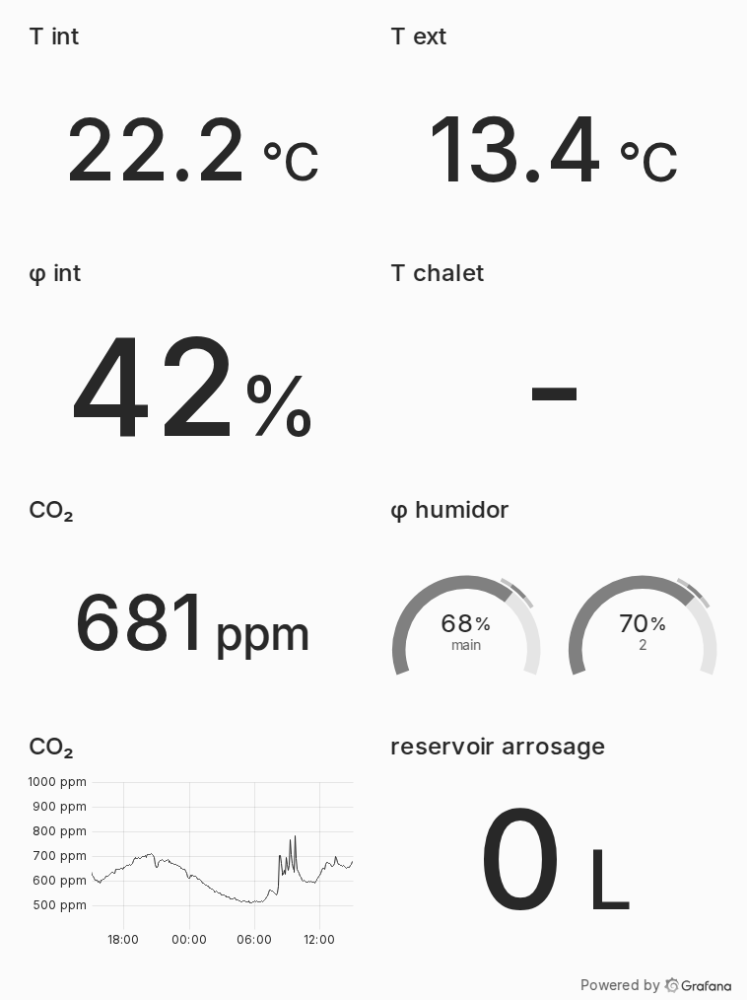
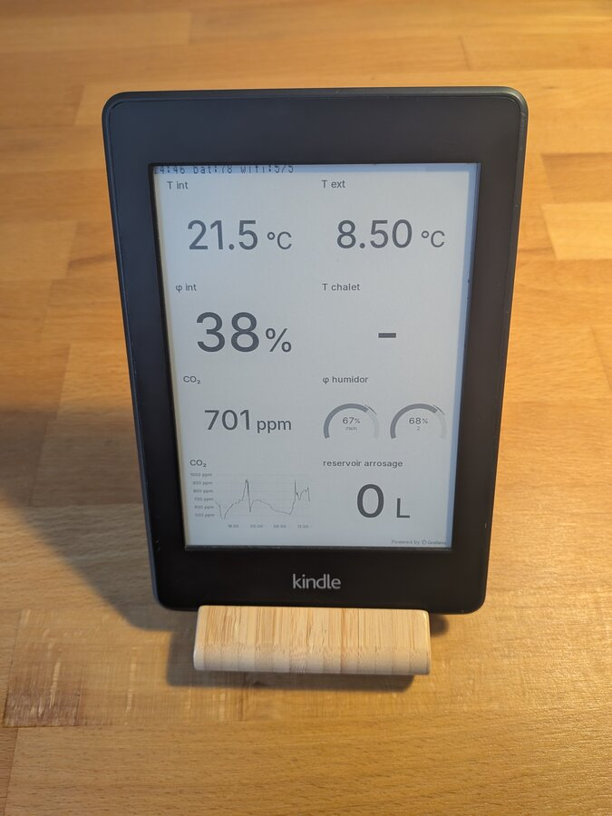

# kindle-dash

Turns a jailbroken Kindle into a dashboard. The server renders a Grafana
dashboard as a grayscale PNG; the Kindle periodically fetches and displays it,
sleeping in between to save battery.

<p align="center">
  
  
</p>

## Client

Shell scripts that run on the Kindle. Adapted from
[pascalw/kindle-dash](https://github.com/pascalw/kindle-dash): modernized to
start as a scriptlet (no KUAL needed) and shrunk down to what I need. It still
uses the same helper binaries (`libexec/next-wakeup` and `libexec/xh`).

Requirements: a jailbroken Kindle with scriptlet support. Images are sized for
a Paperwhite 2 (758x1024).

- `dist/start.sh`: the scriptlet; shows up as "Dashboard" in the library and
  launches `run` in the background.
- `dist/run`: stops the Kindle UI, then loops: fetch the dashboard, display
  it, and suspend until the next scheduled refresh. Shows status screens for
  sleeping, wifi errors and fetch errors. Configured with environment
  variables at the top of the file (`DASHBOARD_URL`, `REFRESH_SCHEDULE`, ...).
- `gen-images.py`: generates the status screens and the scriptlet icon.
- `install`: copies `dist/` to the Kindle over SSH.

The Kindle UI is stopped while the dashboard runs; reboot to get it back.

## Server

A small Scala service (built with Mill) that screenshots a Grafana dashboard
with headless Chromium (via Playwright) and serves it as an 8-bit grayscale PNG
at `/dashboard.png`.

```sh
./mill server.run [--port 8081] <dashboard-url>
```

### Dashboard layout

Set the Grafana dashboard to **auto layout**, with narrow columns and rows and
"fill screen" for rows. With Grafana's regular custom (grid) layout, a small
viewport like the Kindle's makes Grafana switch to its mobile layout, which
puts one panel per row whatever the original arrangement.

### Fragile: relies on Grafana internals

The renderer depends on Grafana's HTML internals, not on any stable API, so a
Grafana upgrade can break it:

1. **Knowing when the page has finished rendering.** Before taking the
   screenshot, it waits for panel elements (`[data-viz-panel-key]`,
   `.react-grid-item`) to appear and for loading indicators (`Panel loading
   bar`, `data-testid*="loading"`) to disappear. If these change, screenshots
   may be taken too early, showing empty or half-loaded panels, or time out.
2. **Larger panel titles.** A CSS hack
   (`[data-testid*='Panel header'] h2 { font-size: 24px }`) enlarges panel
   titles to make them readable on the Kindle. This is the more likely of the
   two to break: if the markup changes, titles silently go back to normal
   size.

After upgrading Grafana, check the rendered image and update the selectors in
`server/src/main.scala` if needed.

### Container image

`./mill server.image` builds a container image with podman. It runs as a
non-root user and only needs `/tmp` to be writable, so it works with a
read-only root filesystem. See `deployment.example.yaml` for an example
Kubernetes deployment.
